# Buntai

Buntai (文体, "writing style") turns a body of writing into a small model that writes in that style, trained and run on your own computer.

Give it a blog URL, a folder of files, or pasted text. It collects the writing, builds a training set from it, fine-tunes a small open model on your GPU, measures how close the result writes to the author, and lets you write with it. Each style is a 33M-parameter adapter on one 4B base model. The model, the writing, the adapters and your drafts stay on the machine.

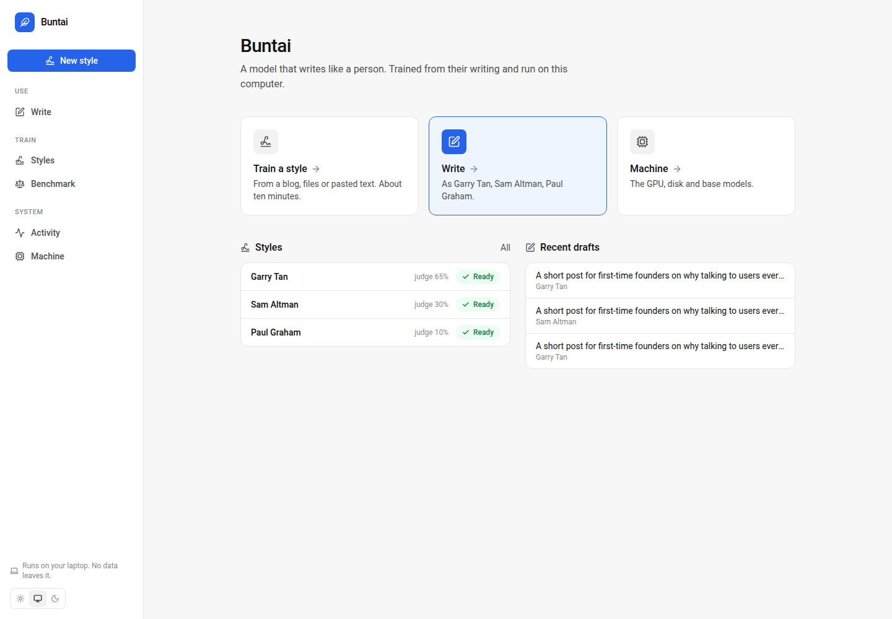

Built in one evening at c0mpiled-18, the YC Startup School hackathon in Taipei, against two Winter 2027 Requests for Startups:

- **LLMs That Write Well.** Frontier models write in one flat house voice. Buntai gives you a model that writes like a specific person or organisation.
- **Own Your Intelligence.** Expertise becomes training data; the model is yours. The style lives in an adapter on your disk, on open weights that run on a laptop.

## Results

Three styles from public essays, trained on one laptop (RTX 5090 Laptop GPU, 24 GB). Two measurements:

- **Judge.** For 20 held-out requests, three writers produce a passage: the untrained base model, the adapter, and GPT-5.5 asked to imitate the author. A judge (gpt-5.4) sees the author's real passage for that request and picks the candidate whose voice is closest. Each request is judged twice with the candidates in different orders.
- **Perplexity.** How predictable the author's real, held-out passages are to the model. They come from posts the model never saw. Lower means closer to how the author writes.

| Style | Writing | Judge: base / GPT-5.5 / adapter (of 40) | Perplexity, base to adapter | Training |
|---|---|---|---|---|
| Garry Tan | 386 posts, 161K words | 0 / 14 / **26** | 18.9 to **11.5** (39% lower) | 762 pairs, 2 epochs, 5 min 45 s |
| Sam Altman | 121 posts, 113K words | 0 / **28** / 12 | 17.9 to **10.0** (44% lower) | 478 pairs, best of 4 epochs, 8 min 27 s |
| Paul Graham | 231 essays, 576K words | 0 / **36** / 4 | 16.9 to **8.7** (48% lower) | 1,056 pairs, best of 4 epochs, 19 min 2 s |

What the three say together:

- **The adapter always learns the author.** Perplexity drops 39% to 48%, and the base model never wins a judgment. Untrained Qwen3-VL-4B writes with bold headers, emoji bullets and hashtags.
- **Against a frontier model told to imitate the author, it wins when the style is idiosyncratic and loses when the author is famous and plain.** Garry Tan writes link posts with first-person asides ("Picture this…"), and the adapter beats GPT-5.5 about 2 to 1 with a judge from GPT's own family. Sam Altman and Paul Graham write plain, analytical prose that GPT-5.5 already produces well and has read in full.
- **Perplexity and the judge can disagree.** With a 4-epoch schedule, held-out perplexity was lowest after epoch 1 in every run (Sam Altman: 9.96, 11.68, 15.32, 17.54), and the trainer kept epoch 1. But a second Garry Tan run on cleaner data, keeping epoch 1 of 4 by perplexity, scored 17 / 22 / 1 with the judge, below the 2-epoch run's 26 / 14 / 0. The epoch with the lowest perplexity is not always the epoch with the closest voice. So every epoch is saved, and `evaluate.py --checkpoints` lets the judge pick the epoch instead; the section on training below shows where that lives.

## How it works

| Step | What happens | Code |
|---|---|---|
| Collect | Crawls a blog's index pages, sitemap or feed (Posthaven, Substack, WordPress, Ghost, old static sites), or reads .txt, .md and .docx files. Decodes the page's declared charset, drops bylines, share counts and trailing link lines. | `pipeline/collect.py` |
| Build | Removes duplicates, interviews, transcripts and show notes. Splits each post into passages of 120 to 380 words at paragraph breaks. An LLM writes two requests per passage, a detailed one and a one-line one, describing content only, never style. Corpora over 600 passages are sampled down. Posts can be excluded by hand. | `pipeline/build.py` |
| Train | LoRA, rank 16, on every attention and MLP projection of Qwen3-VL-4B in bf16. The loss covers the author's words only, never the request. Up to 4 epochs; held-out perplexity is measured after each, every epoch is saved as a checkpoint, and the best epoch becomes the adapter. Small corpora get more epochs so every run has at least 160 steps. A run can also continue from an existing adapter. | `pipeline/train.py` |
| Evaluate | Perplexity before and after, then the blind judge test against GPT-5.5. With `--checkpoints`, the judge first tests every saved epoch against the author's real passages and promotes the one that fools it most often. | `pipeline/evaluate.py` |
| Serve | A local API: styles, runs, data, exclusions, the pipeline runner (one GPU job at a time, cancellable), the machine, and streaming generation. | `pipeline/serve.py` |

What keeps the numbers honest:

- **Held out by post.** Train and eval are split by a hash of the post URL, so no evaluated passage shares a post with a training passage.
- **The model learns phrasing only from the author.** The requests describe content, so everything stylistic in the training targets is the author's.
- **The judge is biased against the adapter.** gpt-5.4 is from the same family as the GPT-5.5 competitor, and models tend to prefer their own family's writing.
- **It learns how someone writes, not what is true.** A 4B model invents facts and anecdotes in the author's voice. A draft is a draft.

## The app

Two jobs, two modes. The first screen asks which you want. The side menu has one button, New style, and three groups of places: Use, Train and System.

### Use

**Write.** Pick a style, say what to write, add notes or a draft to work from, choose a length. The draft streams in and renders as markdown. Edit it in place, copy it, write it again. Recent drafts are kept. No comparisons and no numbers: a writing tool.

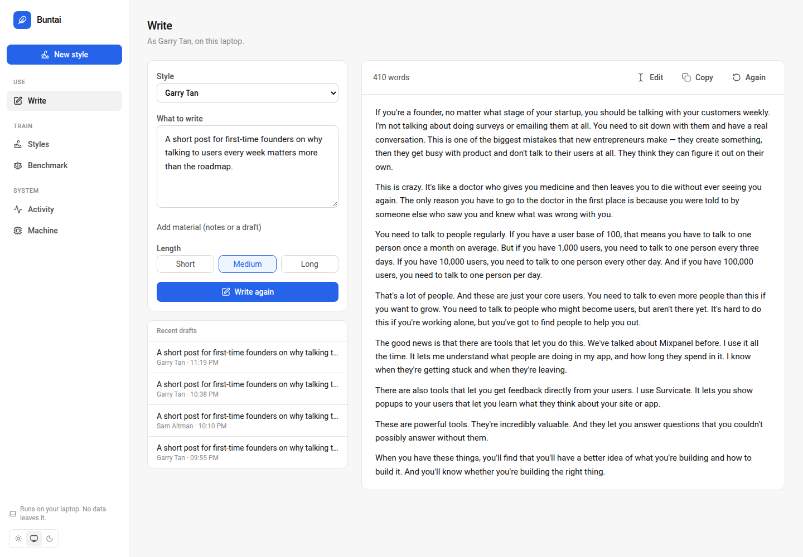

### Train

**New style.** A name and the writing: a URL, uploaded files, or pasted text. Everything else runs on its own. The page says how much writing is enough (20,000 words gives a clear result; 5,000 works with a weaker shift).

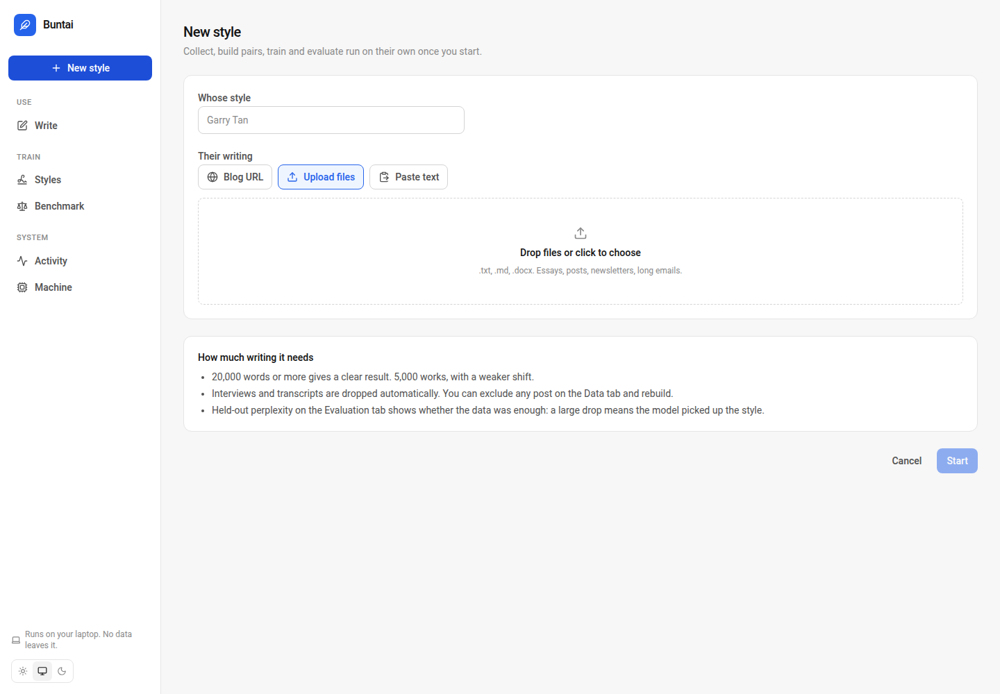

**Styles.** Each style is a card with its numbers; open one for four tabs.

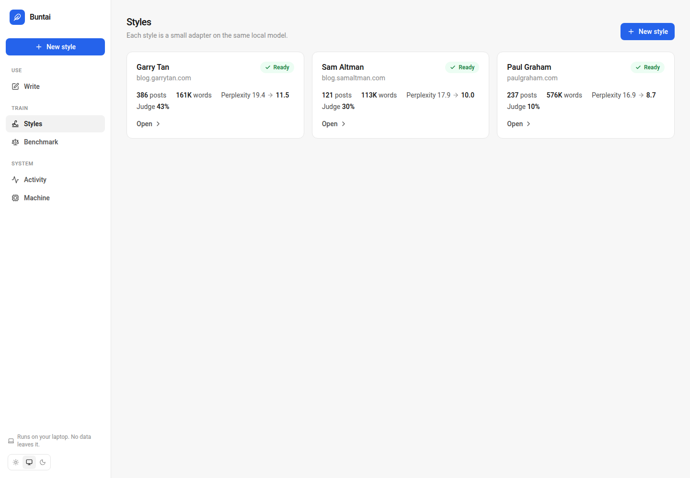

*Overview* shows the four pipeline steps, the headline numbers, and the training curve.

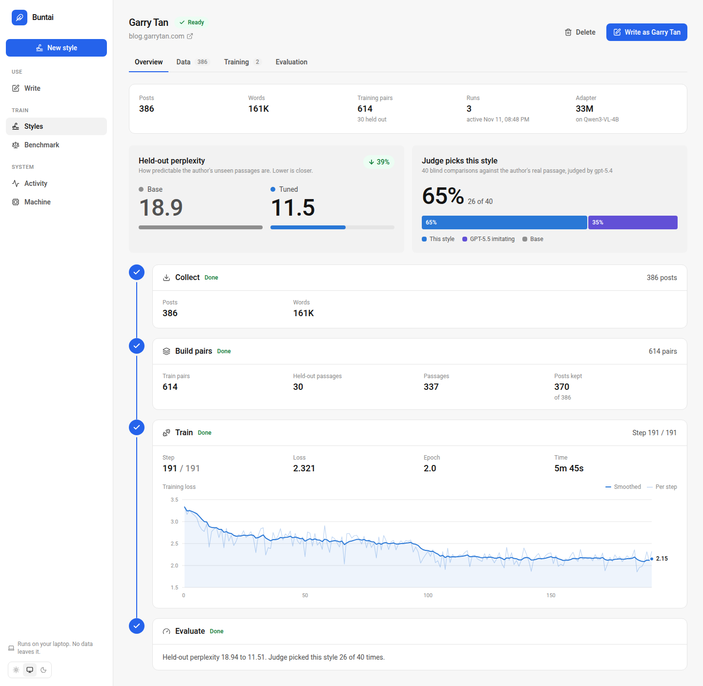

*Data* shows the posts used and dropped, sample passages with the two requests written for them, an Exclude button per post, Add writing (files, text or a URL) and Rebuild and retrain.

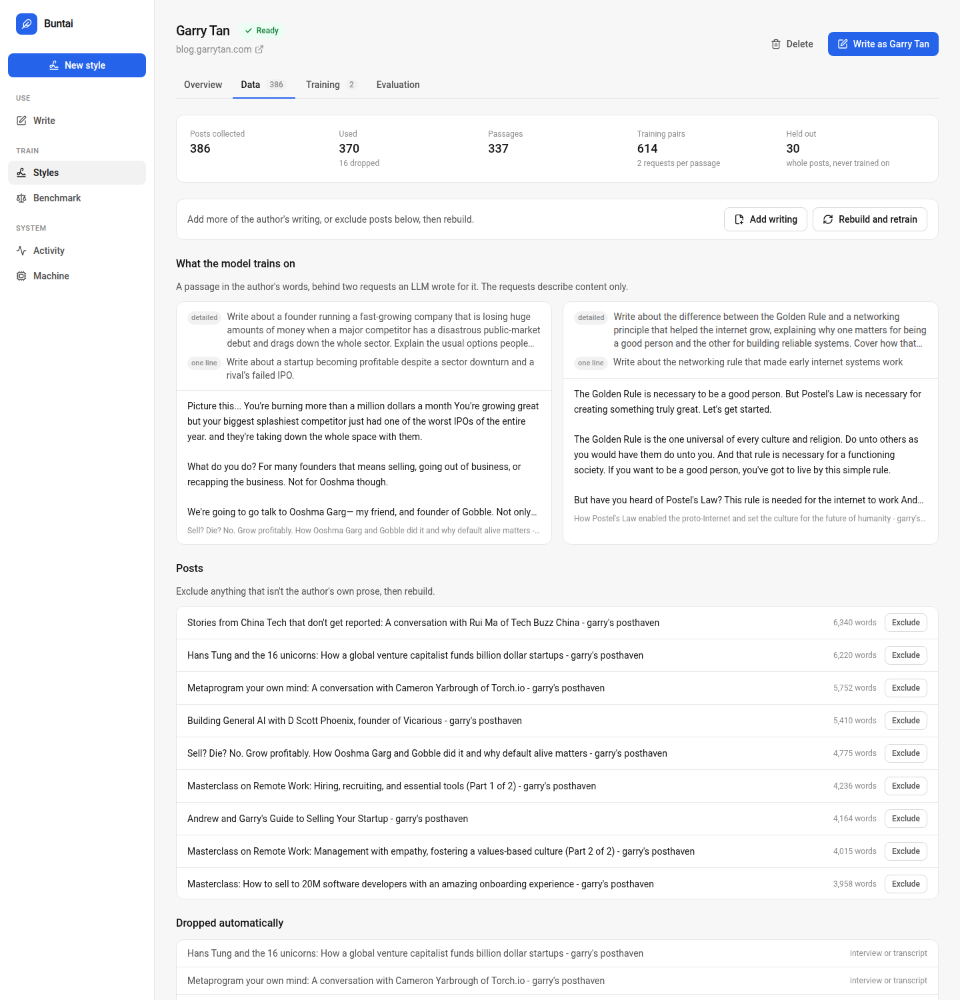

*Training* lists every run with its loss curve and the held-out perplexity after each epoch, marks the epoch kept, and has Continue training (two more epochs from the current adapter at a lower learning rate), Train again (a fresh run in which the judge picks the epoch), Use this run to switch the adapter a style writes with, and Delete run. A style itself is deleted from its page, which removes its runs, adapters, checkpoints, collected writing and pairs.

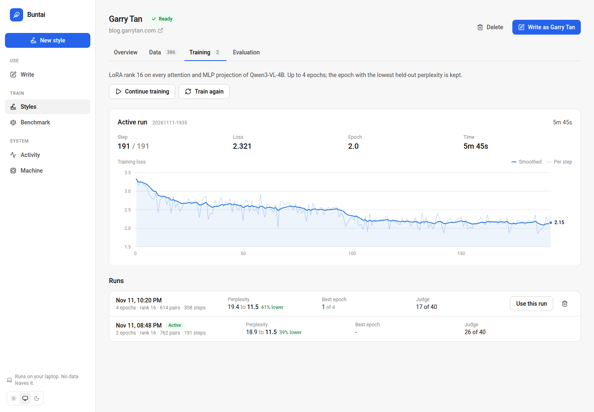

*Evaluation* shows perplexity and the judge result, a blind test you take yourself (the base model and the adapter in random order, then the author's real passage), and every judged sample with all three outputs and the judge's votes.

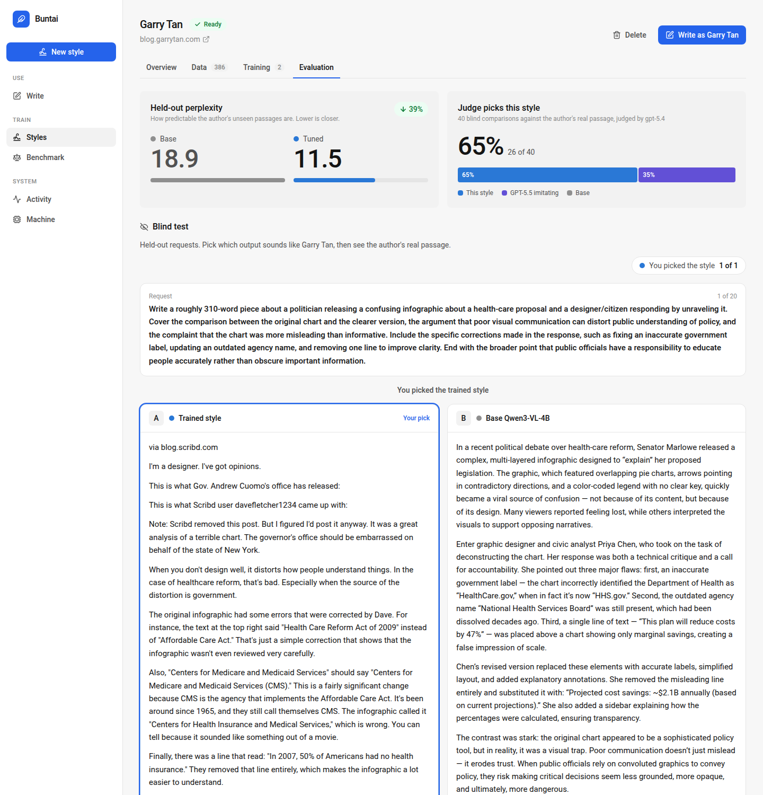

**Benchmark.** One prompt written by the base model, one or two styles, and GPT-5.5 imitating the author, side by side as they stream.

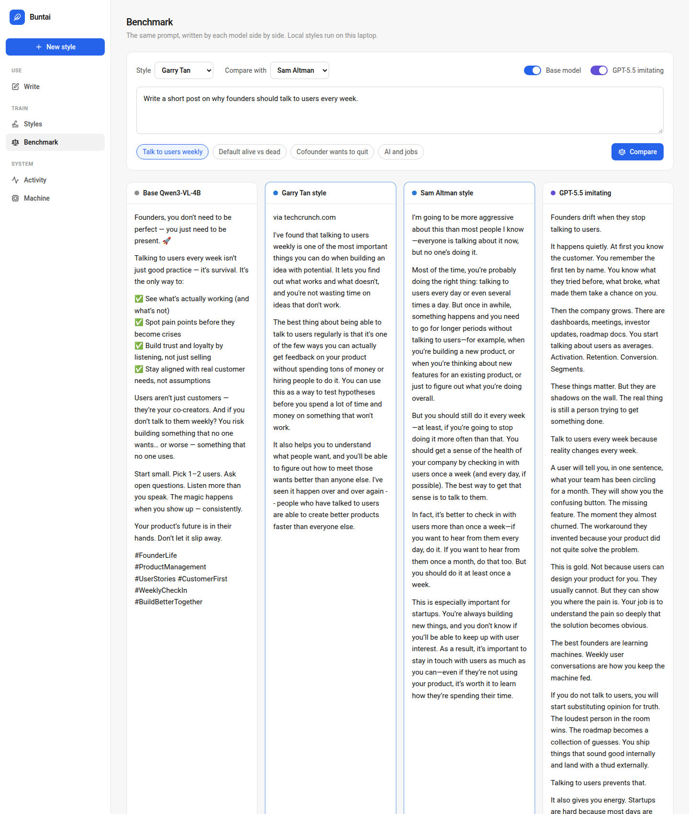

### System

**Activity.** The running job with its progress and a Cancel button, the jobs waiting for the GPU, and a history of finished steps. A live line at the foot of the side menu shows the same from any screen. Training actions say what they will do and how long the GPU will be busy before they start.

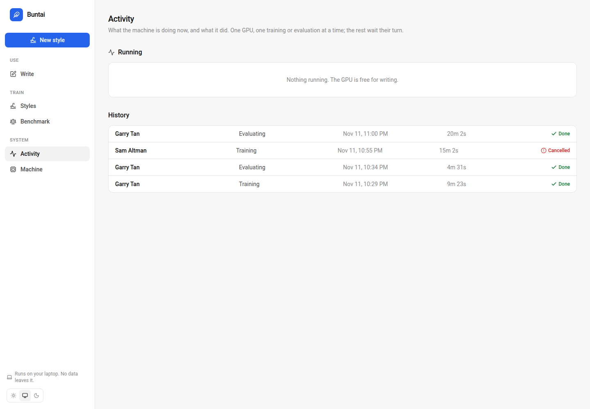

**Machine.** The GPU and RAM, what is running, what is on disk by kind, and the base models: memory needs, a measured training time for a typical style on this GPU, install state, and downloads for the ones that fit.

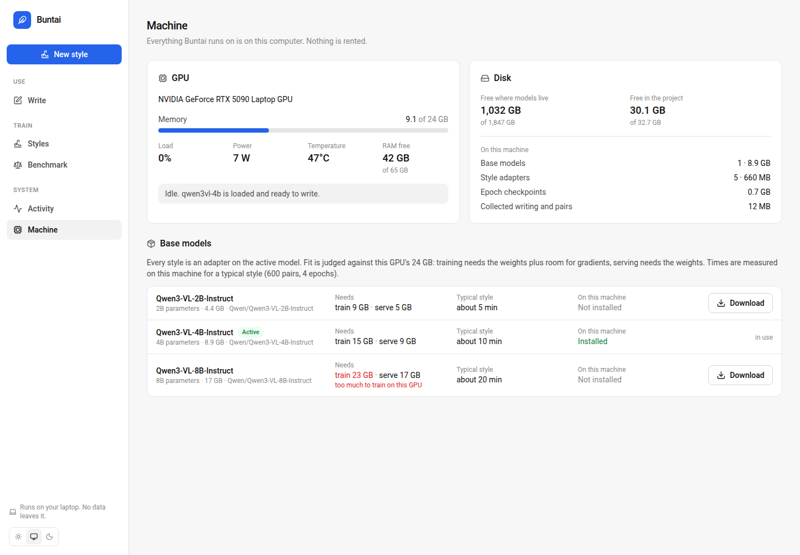

`web/DESIGN.md` describes the tokens, primitives and iconography the screens are built from.

## The same mechanism, other data

Everything above is one mechanism: pairs of (request → text in the target register), a small adapter trained on the target side only, and held-out measurement. Change the pairs and the same code produces a different tool.

- **Your own voice.** Draft an idea in whatever words come, then have your style rewrite it. The pairs are brief → your passage, built from anything you have written: posts, newsletters, long emails.
- **A company's house style, at scale.** Product pages, release notes, support replies and campaign copy that all sound like the company, written by many people and tools. The pairs are brief → the company's published copy. Held-out perplexity says whether the corpus was large enough before anyone ships a word.
- **Register conversion: plain to legal.** Take a body of contracts or filings, have an LLM write the plain-language version of each clause, and train the adapter the other way: plain → legal. The same inverted recipe gives plain → clinical note, plain → regulatory filing, or casual → formal in a second language. Pairs built this way are cheap because the hard side already exists.
- **A publication's editorial voice.** Train on the archive; the adapter drafts in the publication's register and editors do what editors do.

Two cautions apply to every case. The adapter carries form, not facts, so a draft is checked before it leaves the building, and more so in legal and medical settings. And the judge test is the honest signal: for a plain register that frontier models already write well, an adapter can measure closer to the source without beating a frontier model, and the numbers will say so.

## Judge it without running it

Everything a judgment needs is in this repository or linked from it.

- **Judged samples, in full.** For each style, the 20 held-out requests with the author's real passage, the adapter's output, GPT-5.5's imitation, the base model's output, and the judge's two votes: [Garry Tan](docs/samples/garry.md), [Sam Altman](docs/samples/sam.md), [Paul Graham](docs/samples/pg.md).
- **The adapters.** On the Hugging Face Hub, 132 MB each, with model cards: [buntai-garry-tan](https://huggingface.co/mo-haggag/buntai-garry-tan), [buntai-sam-altman](https://huggingface.co/mo-haggag/buntai-sam-altman), [buntai-paul-graham](https://huggingface.co/mo-haggag/buntai-paul-graham). Base model: [Qwen/Qwen3-VL-4B-Instruct](https://huggingface.co/Qwen/Qwen3-VL-4B-Instruct).
- **The data, as an example of how it is organised.** `data/corpus/<style>/posts.jsonl` is what the collector produced (one post per line: url, title, date, text). `data/train/<style>/train.jsonl` and `eval.jsonl` are what the builder produced (chat-format pairs, with the source url and title). The text is the authors' public writing, included here as a research artifact; it comes down on an author's request.
- **The screens**, above, are real screenshots of the app running these styles.

## Run it

Needs an NVIDIA GPU with 16 GB or more, Node 22+, the Qwen3-VL-4B weights in `models/qwen3vl-4b/` (the Machine page downloads them), and `OPENAI_API_KEY` for writing the training requests and the GPT-5.5 comparison. Everything installs inside the project; `env.sh` keeps every cache in `.cache/`.

```bash
source env.sh
python pipeline/serve.py              # API on :8765
cd web && npm install && npm run dev  # UI on :5175
```

Or step by step:

```bash
python pipeline/collect.py  --voice garry --source https://blog.garrytan.com
python pipeline/build.py    --voice garry
python pipeline/train.py    --voice garry
python pipeline/evaluate.py --voice garry --name "Garry Tan" --checkpoints
```

## What is not in this repo

The adapters and checkpoints (on the Hub instead, see above), the base model weights, uploaded files, and the run folders under `runs/` with their logs.
